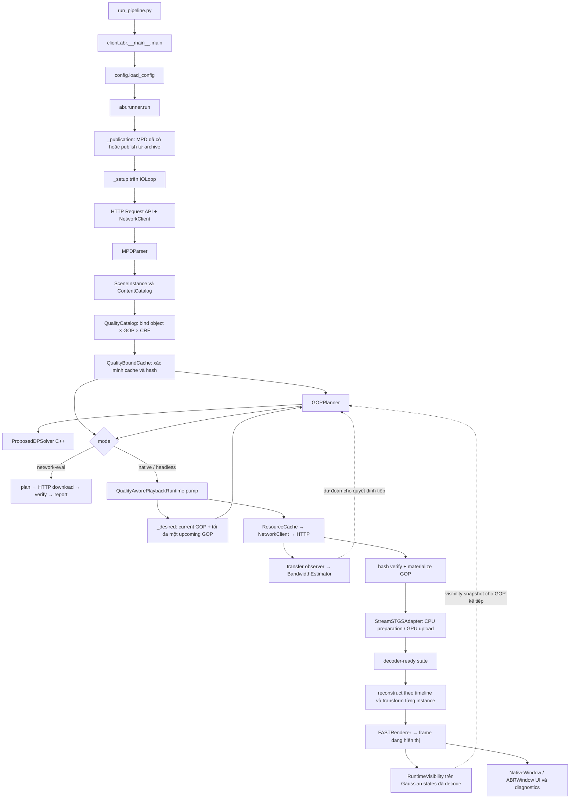

# Luồng thực thi và công thức của pipeline StreamSTGS ABR

Tài liệu này lần theo implementation production được gọi bởi [`run_pipeline.py`](../run_pipeline.py). Nó mô tả thứ tự các module thực sự chạy, dữ liệu truyền giữa chúng, cùng công thức visibility, bandwidth prediction và adaptation. Các tên module bên dưới trỏ tới code hiện hành trong `src_final/multiobj3dgs/`.

## 1. Sơ đồ thực thi

Mũi tên từ visibility quay lại planner là một vòng theo thời gian: `pump()` xác định yêu cầu và lập quyết định trước; khi có frame đã hiển thị, analyzer cập nhật visibility. Snapshot đó được giữ theo chính sách current-pose hold và dùng ở quyết định tiếp theo. Bandwidth được cập nhật sau các HTTP transfer hoàn tất, rồi runner lấy estimate bất đồng bộ khoảng mỗi 0.25 giây.

## 2. Từ entry point tới các module

| Thứ tự | Module / hàm | Việc thực hiện và dữ liệu đầu ra |
|---|---|---|
| 1 | [`run_pipeline.py`](../run_pipeline.py) | Thêm `src_final` vào import path và gọi entry point production. File này không chứa logic ABR. |
| 2 | [`client/abr/__main__.py`](../src_final/multiobj3dgs/client/abr/__main__.py) → `main()` | Gọi parser cấu hình, sau đó gọi `runner.run(config)`. |
| 3 | [`client/abr/config.py`](../src_final/multiobj3dgs/client/abr/config.py) → `load_config()` | Đọc JSON/CLI, chuẩn hóa content IDs, kiểm tra các ngưỡng. Mặc định `eta=0.85`, `Δ=0.25 Mbps`, prior khởi động 20 Mbps, cửa sổ 5 mẫu và origin localhost không pace. |
| 4 | [`client/abr/runner.py`](../src_final/multiobj3dgs/client/abr/runner.py) → `_publication()` | Dùng MPD/publication có sẵn; nếu chưa có, gọi publisher trên archive StreamSTGS đã cấu hình. Publication hiện có được dùng lại. |
| 5 | `runner.run()` → `_setup()` | Tạo `IOLoop`, `NetworkClient`, transfer observer, bandwidth estimator, HTTP origin tùy chọn, MPD catalog, quality catalog và cache. Tất cả MPD/media đi qua HTTP Request API; local MPD được phục vụ bằng HTTP. |
| 6 | [`client/metadata`](../src_final/multiobj3dgs/client/metadata) → `MPDParser.from_http()` | Đọc MPD qua HTTP, tạo content/representation/GOP/resource metadata. [`runner._scene()`](../src_final/multiobj3dgs/client/abr/runner.py) tạo các `SceneInstance` độc lập, kể cả duplicate content có transform, offset, active interval và loop riêng. |
| 7 | [`client/abr/catalog.py`](../src_final/multiobj3dgs/client/abr/catalog.py) và [`quality_metadata.py`](../src_final/multiobj3dgs/client/abr/quality_metadata.py) | Nạp quality bundle, tra PSNR theo `(content_id, gop_index, crf)`, kiểm tra hash/schema, GOP duration, timestamps, source frame/model time và file manifest khớp publication. |
| 8 | [`client/abr/binding.py`](../src_final/multiobj3dgs/client/abr/binding.py), [`client/abr/network.py`](../src_final/multiobj3dgs/client/abr/network.py), cache production | Xác minh resource cache resident; tính số byte còn phải tải theo SHA-256 unique; materialize segment qua cache; sau tải xác minh package đúng representation đã đo. Cache hit không tạo request hay bandwidth sample giả. |
| 9 | [`client/abr/planner.py`](../src_final/multiobj3dgs/client/abr/planner.py) → `GOPPlanner.plan()` | Tạo lựa chọn quality theo GOP: utility từ measured PSNR và visibility; cost từ byte còn thiếu, duration và shared-resource policy; gửi bài toán MCKP cho solver hoặc fixed mode. |
| 10 | [`client/abr/solver.py`](../src_final/multiobj3dgs/client/abr/solver.py) và [`client/abr/native/`](../src_final/multiobj3dgs/client/abr/native/) | C ABI Python gọi C++ Proposed DP đã kiểm chứng. Khi cần, compile riêng bridge/solver một kali và cache thư viện; không chạy benchmark/experiment lúc player start. |
| 11 | [`client/abr/runtime.py`](../src_final/multiobj3dgs/client/abr/runtime.py) → `QualityAwarePlaybackRuntime` | Kế thừa production `PlaybackRuntime`; quyết định GOP hiện tại và tối đa một GOP prefetch tiếp theo trên mỗi instance. Selection đã admit được giữ cố định tới GOP boundary; manual override hiện có được áp dụng ở boundary kế tiếp. |
| 12 | [`client/runtime/playback.py`](../src_final/multiobj3dgs/client/runtime/playback.py), [`client/cache/resources.py`](../src_final/multiobj3dgs/client/cache/resources.py), [`codecs/streamstgs`](../src_final/multiobj3dgs/codecs/streamstgs) | Runtime tạo/cancel job; cache tải và materialize GOP; adapter chuẩn bị model tăng dần trên CPU, upload GPU theo budget và phát readiness events. Worker pool, byte budgets, decoder handles và stall clock thuộc runtime production. |
| 13 | [`client/abr/visibility.py`](../src_final/multiobj3dgs/client/abr/visibility.py), [`client/visibility/analyzer.py`](../src_final/multiobj3dgs/client/visibility/analyzer.py) | Sau frame render/refresh, lấy đúng Gaussian states và provenance đang hiển thị, chạy contribution analysis ở viewport thu nhỏ theo cadence, cập nhật weight theo instance. Không decode lại GOP và không tạo thêm ảnh RGB đầy đủ. |
| 14 | [`client/rendering/fast.py`](../src_final/multiobj3dgs/client/rendering/fast.py), [`client/viewer/window.py`](../src_final/multiobj3dgs/client/viewer/window.py), [`client/abr/diagnostics.py`](../src_final/multiobj3dgs/client/abr/diagnostics.py) | FAST renderer hiển thị joint scene. Native `ABRWindow` kế thừa controls và UI gốc; diagnostics bổ sung trạng thái ABR, bandwidth, visibility, GOP, requests và playback. |
| 15 | [`client/abr/runner.py`](../src_final/multiobj3dgs/client/abr/runner.py) cleanup | Đóng runtime/decoder, renderer, window, cache, HTTP client, origin và I/O loop; lưu JSON report và JSONL telemetry. |

### Hai mode trong runner

- `native` và `headless` chạy playback runtime, decoder và renderer. `native` thêm cửa sổ tương tác. `headless` không mở cửa sổ; nó vẫn chạy playback/render loop.
- `network-eval` gọi `_network_evaluation()`: lập quyết định từng GOP, tải representation đã chọn bằng HTTP, xác minh byte union và ghi telemetry. Mode này **không** chạy visibility, decode hoặc render; do đó kết quả của nó không phải phép đo viewport quality hay rebuffering.

## 3. Timeline độc lập của từng instance

Với instance $i$, scene start $s_i$, media offset $o_i$, scene time $t$, và active duration $a_i$, runtime xác định:

\[
e_i(t)=t-s_i,\qquad
\tau_i(t)=o_i+e_i(t).
\]

Nếu $e_i(t)<0$, hoặc $e_i(t)≥a_i$ khi có active duration, instance chưa hoạt động hay đã kết thúc. Với loop, media time được wrap theo duration nội dung $D_i$:

\[
\tau_i^{\mathrm{loop}}(t)=\tau_i(t)\bmod D_i.
\]

Nếu không loop và τ nằm ngoài nội dung, instance không tạo frame. `media_time()` ở [`client/scene/timeline.py`](../src_final/multiobj3dgs/client/scene/timeline.py) có thêm xử lý roundoff theo ULP và snap timestamp gần frame boundary. Sau đó runtime tìm segment/GOP chứa media time, tra `source_frame`/`model_time` trong MPD mapping, áp dụng transform riêng của instance và gọi StreamSTGS adapter. Vì vậy hai instance dùng cùng content vẫn có clock, GOP choice, transform và decoder handle độc lập.

## 4. Visibility: alpha/transmittance contribution

### 4.1 Contribution của một object

Analyzer chạy trên Gaussian states đã reconstruct tại camera pose hiện tại. Xét pixel $p$, các Gaussian splats theo thứ tự compositing là $j=1,...,m_p$. Với opacity sau projection $α_{p,j}$, transmittance tới splat $j$ là:

\[
T_{p,j}=\prod_{\ell<j}(1-\alpha_{p,\ell}).
\]

Contribution alpha của splat là $T_{p,j}α_{p,j}$. Nếu $G_i$ là các splat thuộc instance $i$, contribution pixel của instance trong render chung là:

\[
c^{\mathrm{joint}}_{i,p}
=\sum_{j\in G_i}T_{p,j}\alpha_{p,j},\qquad
A_i^{\mathrm{visible}}=\sum_{p}c^{\mathrm{joint}}_{i,p}.
\]

Implementation dùng màu hằng theo slot/object để mã hóa contribution trong pass joint; geometry, opacity, thứ tự compositing và các object occluder đều giữ trong pass. Các object được xử lý theo nhóm tối đa ba slot mỗi pass. Analyzer cũng render từng object ở chế độ solo để lấy:

\[
A_i^{\mathrm{solo}}=\sum_p c^{\mathrm{solo}}_{i,p}.
\]

Solo area là tham chiếu cho tỷ lệ bị che khuất, không phải visibility weight dùng trực tiếp trong objective. Analyzer báo:

\[
o_i=1-\frac{A_i^{\mathrm{visible}}}{A_i^{\mathrm{solo}}}
\]

khi $A_i^{solo}>ε$. Nếu solo area không vượt epsilon, object được đánh dấu ngoài view và occlusion ratio không xác định. Sai số số học nhỏ được clamp; vi phạm lớn như $A^{visible}>A^{solo}$ bị báo lỗi.

### 4.2 Weight đi vào planner

RuntimeVisibility giảm camera về chiều rộng tối đa `analysis_width` (mặc định 256), giữ aspect ratio, rồi chuẩn hóa contribution theo số pixel của analysis viewport $P=W_aH_a$:

\[
v_i=\frac{A_i^{\mathrm{visible}}}{P}.
\]

Trong mỗi cohort GOP được lập kế hoạch, planner chuẩn hóa các weight:

\[
w_i=\frac{v_i}{\sum_{j\in\mathcal I}v_j},
\]

với $I$ là các instance cần quyết định trong cohort. Nếu chưa có visibility snapshot khi startup, planner dùng weight đồng đều $w_i=1/|I|$. Nếu đã có snapshot nhưng tổng contribution bằng 0 thì code giữ các weight bằng 0; khi đó utility của các lựa chọn trong cohort đều bằng 0 và tie-break của DP quyết định kết quả.

Snapshot gắn với timestamp/frame provenance thật đang hiển thị. Analyzer chỉ chạy sau khi có state hợp lệ, theo `visibility_interval_s` (mặc định 2 giây), hoặc khi ép cập nhật sau camera control. Snapshot được giữ cho quyết định kế tiếp theo `current_pose_hold`; implementation chưa dự đoán pose tương lai và không tra view-conditioned quality theo camera. Backend hiện ghi là CUDA contribution analysis và `exact_fast_contribution=false`; đây là phép đo alpha contribution ở độ phân giải phân tích, không phải phép đo PSNR của frame FAST.

## 5. Bandwidth prediction từ HTTP transfers

### 5.1 Gom transfer thành một sample

`PipelineTransferObserver` nhận kết quả từ HTTP Request API. Chỉ media/shared-asset transfers đủ điều kiện mới góp vào estimator. Mọi bytes thành công hoặc thất bại vẫn đi vào traffic ledger. Cache hit không có HTTP transfer nên không tạo sample.

Với một nhóm transfer hoàn tất $r=1,...,R$, số byte nhận được:

\[
B_{\mathrm{bytes}}=\sum_{r=1}^R b_r.
\]

Thời gian bận là độ dài hợp của các khoảng HTTP request, tính cả TTFB và không cộng chồng các request song song:

\[
T_{\mathrm{busy}}=\left|\bigcup_{r=1}^{R}[t_r^{start},t_r^{end}]\right|.
\]

Goodput sample được tính:

\[
g=\frac{8B_{\mathrm{bytes}}}{T_{\mathrm{busy}}}\quad\text{bit/s}.
\]

Một GOP materialization gom bundle và shared assets thành một batch để các file nhỏ tuần tự không chi phối harmonic mean. Nếu có request trong batch bị lỗi hoặc bị hủy, batch đó không tạo capacity sample; bytes đã nhận vẫn được ghi. Việc gộp các khoảng thời gian tránh cộng nhầm tốc độ của các HTTP request đồng thời.

### 5.2 Harmonic mean, freshness và bootstrap

Estimator giữ tối đa $n=5$ sample hợp lệ gần nhất (cấu hình được), bỏ sample cũ hơn `bandwidth_max_age_s` (mặc định 30 giây trong pipeline). Với các goodput tươi $g_1,...,g_m$, estimate là harmonic mean:

\[
\widehat C=H(g_1,\ldots,g_m)
=\frac{m}{\sum_{r=1}^{m}1/g_r}.
\]

Harmonic mean phản ứng thận trọng khi một trong các transfer có tốc độ thấp. Khi chưa có sample tươi, estimator trả prior startup (mặc định $20×10^6$ bit/s) với trạng thái `bootstrap`; đây là prior cho planner, không giới hạn tốc độ localhost. Nếu không cấu hình prior, estimate là unavailable. Estimate và sample age/status được đưa vào diagnostics.

### 5.3 Safety budget

Planner áp dụng safety factor η (mặc định 0.85) rồi làm tròn xuống số nguyên bit/s:

\[
B=\left\lfloor\eta\widehat C\right\rfloor,\qquad 0<\eta\le1.
\]

Estimate được lấy từ HTTP transfer thật; `--server-mbps` hoặc `--delivery-trace` chỉ bật khi người chạy muốn pace/emulate origin. Mặc định localhost dùng HTTP không pace. Với external origin, delivery rate do origin/network thật quyết định.

## 6. ABR utility, GOP cost và ràng buộc

### 6.1 Chất lượng $Q_{ikg}$

Với instance $i$, GOP $g$, representation/CRF $k$, planner truy vấn PSNR đã đo từ quality catalog:

\[
Q_{ikg}=\texttt{QualityCatalog.psnr}(\text{content}_i,g,\text{CRF}_k).
\]

Metadata hiện dùng arithmetic mean PSNR theo dB trên 60 frame × 24 reference views ở scale 1.0, gồm cả training và held-out views. Tức là profile tổng hợp dùng:

\[
Q_{ikg}=\frac{1}{60\cdot24}\sum_{f=1}^{60}\sum_{v=1}^{24}
\mathrm{PSNR}_{ikgf v},\qquad
\mathrm{PSNR}=10\log_{10}\!\left(\frac{L^2}{\mathrm{MSE}}\right).
\]

Runtime tra giá trị tổng hợp có sẵn; nếu thiếu profile cho content/GOP/CRF thì catalog báo lỗi thay vì tự điền metric. Nó không tạo lại PSNR, không nội suy giữa CRF, không dùng CRF rank làm utility và không giả định PSNR đơn điệu theo CRF. Với camera tương tác không trùng reference view, policy hiện hành vẫn dùng aggregate theo GOP/CRF; không coi metric đó là PSNR viewport thực tế.

`QualityCatalog` chỉ cho phép gắn profile khi content/GOP/CRF, duration, timestamp mapping, source frame/model time, member list và representation hashes khớp MPD/publication. Mỗi GOP sau HTTP còn được `QualityBoundCache` kiểm tra manifest và member hashes trước khi decoder dùng.

### 6.2 Chi phí transfer theo GOP và cache

Cost phải mô tả byte thật còn phải lấy cho GOP đã chọn, thay vì bitrate trung bình toàn nội dung trong MPD. Gọi $R_{ikg}$ là resource refs của representation đó, $h$ là SHA-256, $b_h$ là bytes. Tập resource còn thiếu sau khi chỉ ghi nhận cache entry resident đã hash-verify là:

\[
\mathcal M_{ikg}=\{h\in\mathcal R_{ikg}:h\text{ chưa resident/verified}\}.
\]

Cost optional theo code được cộng trên từng resource, làm tròn lên riêng từng hạng:

\[
r_{ikg}^{optional}
=\sum_{h\in\mathcal M_{ikg}\setminus\mathcal H_{mandatory}}
\left\lceil\frac{8b_h}{d_g}\right\rceil,
\]

trong đó $d_g$ là duration GOP và $H_{mandatory}$ là các SHA-256 xuất hiện ở mọi lựa chọn representation cho cùng instance. Các hash bắt buộc này được tính một lần với service rate bảo thủ lớn nhất qua các duration lựa chọn:

\[
r_h^{mandatory}=\max_{k}\left\lceil\frac{8b_h}{d_{g,k}}\right\rceil,\qquad
r_{fixed}=\sum_{h\in\mathcal H_{mandatory}}r_h^{mandatory}.
\]

Shared hash tính theo SHA và bytes, tránh cộng lặp một asset bắt buộc. Các duplicate instance chỉ được gộp thành một hàng lựa chọn khi cùng content/GOP và có alternatives khớp về representation, duration, PSNR, hash và bytes; khi đó một lần tải có thể cấp immutable payload chung cho các instance, utility của chúng được cộng. Các trường hợp chia sẻ optional khác vẫn tính cộng bảo thủ để không đánh giá thấp yêu cầu tải.

Sau khi chọn xong, planner cũng tính exact missing-byte union:

\[
B_{union}=\sum_{h\in\cup_i\mathcal M_{i,k_i,g_i}}b_h,
\qquad
r_{union}=\left\lceil\frac{8B_{union}}{\min_i d_{g_i}}\right\rceil.
\]

Đây là upper bound bảo thủ để chẩn đoán khi GOP có duration khác nhau. `feasible=true` chỉ khi solver/fixed mode có trạng thái hợp lệ, additive model nằm trong budget **và** union-rate bound nằm trong budget. Report cũng giữ riêng `estimated_rate_bps`, `exact_missing_union_bytes` và `union_rate_upper_bound_bps`.

### 6.3 Weighted PSNR objective và constraints

Planner tạo bốn lựa chọn measured CRF cho mỗi hàng/nhóm $j$. Với instance weights đã chuẩn hóa, utility của lựa chọn $k$ là:

\[
u_{jk}=\sum_{i\in j}w_iQ_{ikg_i}.
\]

Nếu không có clone grouping thì $j$ chỉ chứa một instance, nên $u_{ik}=w_iQ_{ikg}$. Bài toán MCKP được giải là:

\[
\max_{x_{jk}}\quad\sum_j\sum_{k=1}^{4}x_{jk}u_{jk}
\]

subject to:

\[
\sum_{k=1}^{4}x_{jk}=1\quad\forall j,
\qquad
r_{fixed}+\sum_j\sum_{k=1}^{4}x_{jk}r_{jk}^{optional}\le B,
\qquad x_{jk}\in\{0,1\}.
\]

Implementation gán $r_{fixed}$ vào cost của hàng solver đầu tiên, để không phát sinh hàng giả hoặc làm tròn thêm một lần. Locked representation được biểu diễn thành bốn lựa chọn giống nhau về mặt solver; như vậy planner giữ đúng representation đã commit cho GOP đó.

### 6.4 Discretization và C++ Dynamic Programming

Với bước mặc định $Δ=250,000$ bit/s, solver rời rạc hóa cost bảo thủ:

\[
\widetilde r_{jk}=\left\lceil\frac{r_{jk}}{\Delta}\right\rceil,
\qquad
\widetilde B=\left\lfloor\frac{B}{\Delta}\right\rfloor.
\]

DP theo số hàng $j$ và capacity $b$ là:

\[
DP_j(b)=\max_{k:\widetilde r_{jk}\le b}
\left[DP_{j-1}(b-\widetilde r_{jk})+u_{jk}\right].
\]

Backpointer cho từng trạng thái khôi phục đúng một representation index mỗi hàng. Vì các cost được làm tròn lên còn budget làm tròn xuống, nghiệm khả thi trên grid không thể vượt budget gốc; Python bridge còn tính lại cost nguyên gốc, kiểm tra selection và utility sau khi C++ trả kết quả. CRF alternatives được sắp ổn định; C++ duyệt index tăng và chỉ thay đáp án khi utility tăng nghiêm ngặt, nên tie có kết quả deterministic.

Solver phân biệt `infeasible` (tổng cost tối thiểu thực tế đã vượt $B$) với `discretized_infeasible` (bài toán thực có thể feasible nhưng grid loại hết lựa chọn). Mặc định solver giới hạn thời gian 0.5 giây và bảng backpointer tối đa 50 triệu DP cells; các giới hạn thời gian và số cells có status riêng. Khi không có nghiệm tối ưu, planner chọn alternative có additive GOP cost thấp nhất theo từng nhóm, vẫn phát request, ghi `feasible=false` và cho phép runtime báo stall/rebuffer; nó không gắn nhãn nghiệm vượt budget là feasible. Fixed-quality mode là debugging baseline và cũng được kiểm tra feasibility.

## 7. Từ quyết định tới frame hiển thị

1. `QualityAwarePlaybackRuntime._desired()` lấy media time riêng từng instance, xác định current GOP và, nếu bật prefetch, tối đa một upcoming GOP. Một upcoming cohort chỉ được lập kế hoạch khi current cohort đã được admit/ready; decision được đóng băng theo GOP boundary.
2. `_plan()` gửi target GOP, bandwidth estimate, visibility snapshot, locked selections và loop/generation context sang `GOPPlanner.plan()`.
3. Sau decision, runtime tạo/cancel `GopJob` phù hợp. Job mới gọi `cache.materialize(segment)` bất đồng bộ. Request URL/CRF/GOP chính là segment trong representation được chọn; response đi qua cache, SHA verification, quality binding rồi mới tới decoder.
4. Worker pool xử lý progressive temporal preparation. Runtime quản lý reservation CPU/GPU, upload budget, readiness và ưu tiên job đến hạn. Nếu representation chưa decoder-ready ở playback deadline, clock stall; khi ready, playback tiếp tục.
5. Khi frame tới hạn, `PlaybackRuntime.reconstruct()` tra model time cho từng instance, áp independent spatial transform rồi renderer vẽ chung các state. Timeline không bị đặt lại khi representation chuyển ở boundary vì source/media timestamp mapping được kiểm tra với measured profile.
6. Sau frame/refresh đã hiển thị, `RuntimeVisibility.sample()` tính weight cho camera pose đó. Lần adaptation kế tiếp có thể đổi allocation nếu visibility hoặc bandwidth đã thay đổi.

Manual controls tiếp tục thuộc production viewer/runtime: camera, pause/play, seek/restart, loop và manual quality. Quality thủ công trở thành override tại GOP boundary kế tiếp. `ABRWindow` bổ sung trạng thái ABR nhưng kế thừa callbacks, draw panel và swap từ `NativeWindow`.

## 8. Dữ liệu telemetry và giới hạn hiện tại

`runner.py` ghi JSON report và JSONL event stream. Event liên quan gồm cấu hình/catalog revision, request start/completion/cancel, bytes và throughput, bandwidth sample/estimate, visibility snapshot, ABR decision/selection/cost/utility, decoder states, scene frame, stalls, GPU/memory và native presentation. Các số này giúp ghép lại chuỗi `estimate → decision → request → ready → frame` theo timestamp.

Các chính sách cần giữ khi đọc kết quả:

- Visibility là contribution snapshot ở pose hiện tại và resolution phân tích; chưa có camera/viewport prediction.
- Quality utility là aggregate measured PSNR dB theo GOP/CRF trên reference views; không phải viewport-conditioned PSNR cho camera tùy ý.
- Bandwidth là harmonic mean của HTTP body-goodput samples còn fresh; startup prior chỉ áp dụng trước khi có sample mới.
- Cost là GOP-specific resource transfer cost có cache/hash/shared-asset accounting. Với overlap không đủ điều kiện clone chính xác, cost additive bảo thủ; union-rate bound báo thêm feasibility riêng.
- Solver tối ưu MCKP rời rạc hóa; `optimal` là tối ưu trên grid bảo thủ, không tuyên bố nghiệm continuous-cost exact.
- Hiện không có buffer constraint C3, QoE/stall penalty trong objective, DRL hay joint network/GPU-compute optimization. Decoder scheduling, GPU memory và playback readiness vẫn do runtime quản lý độc lập với utility solver.

## 9. Bảng tra nhanh module

| Trách nhiệm | Module chính | Interface quan trọng |
|---|---|---|
| CLI/config | `client/abr/config.py`, `client/abr/__main__.py` | `load_config(argv)`, `main(argv)` |
| Orchestration | `client/abr/runner.py` | `_publication`, `_setup`, `_planner`, `_native`, `run` |
| MPD/catalog | `client/metadata`, `client/abr/catalog.py` | `MPDParser.from_http`, `QualityCatalog.profile/psnr` |
| Quality integrity | `client/abr/quality_metadata.py`, `client/abr/binding.py` | `load_dataset`, `QualityBoundCache.materialize` |
| HTTP/cache telemetry | `shared/transfer`, `client/cache`, `client/abr/network.py` | `NetworkClient`, `PipelineTransferObserver`, `missing_bytes` |
| Bandwidth | `client/network/bandwidth.py` | `BandwidthEstimator.accept_transfer_sample`, `estimate_bandwidth` |
| Visibility | `client/visibility/analyzer.py`, `client/abr/visibility.py` | `VisibilityAnalyzer.analyze`, `RuntimeVisibility.sample` |
| Adaptation | `client/abr/planner.py`, `client/abr/solver.py`, `client/abr/native/` | `GOPPlanner.plan`, `ProposedDPSolver.solve` |
| Playback/decode | `client/abr/runtime.py`, `client/runtime/playback.py`, `codecs/streamstgs` | `QualityAwarePlaybackRuntime.pump`, production decoder state machine |
| Timeline/transforms | `client/scene/timeline.py`, `shared/metadata.py` | `media_time`, per-instance `SceneInstance` |
| Render/viewer | `client/rendering/fast.py`, `client/viewer/window.py`, `client/abr/diagnostics.py` | `FASTRenderer`, inherited `NativeWindow`, `ABRWindow` |
| Local HTTP emulation | `client/abr/network_delivery.py` | `PacedHTTPOrigin`; unthrottled by default, pacing opt-in |
| Evidence/metrics | `client/abr/capture.py`, `client/abr/metrics.py` | optional capture and explicitly labeled viewport quality proxy |
