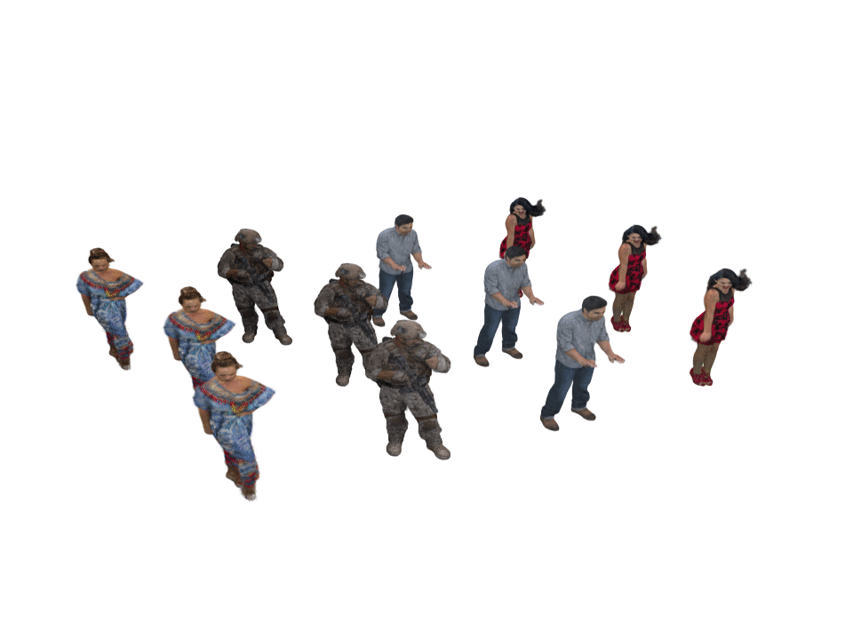

<div align="center">

# MultiObj3dgsVstream

**Visibility-aware streaming for multi-object dynamic 3D Gaussian scenes**

[Overview](#overview) · [Getting started](#getting-started) · [Interactive demo](#interactive-demo) · [Evaluation](#evaluation) · [Reproducibility](#reproducibility)

</div>



<p align="center">
  <sub>Longdress · Soldier · Loot · Redandblack — twelve instances, a camera sweep, a pause and a close-up, followed by visibility contribution views.</sub>
</p>

## Overview

A scene can contain many dynamic objects, but they do not all contribute equally to what a viewer sees. **MultiObj3dgsVstream** connects object visibility, measured quality profiles and bandwidth-aware resource allocation to explore how streaming quality should be distributed across a scene.

The framework combines:

- **Visibility-aware adaptation:** alpha/transmittance contributions guide Visibility × MSE, Visibility × PSNR and weighted-SSE objectives.
- **Streaming experiments:** causal bandwidth estimation, native dynamic programming, multiplexed HTTP/2 delivery and continuous playback-buffer accounting.
- **Interactive playback:** navigate dynamic Gaussian scenes, change object quality, pause and seek with the native CUDA/OpenGL viewer.
- **Comparison methods:** run the existing NAVA-adapted, Exhaustive Search and SSE baselines through the shared evaluation pipeline.

The preview uses the existing **fixed CRF20** mode for visual clarity. Its timing is edited for presentation, and the final contribution maps come from the CUDA visibility analyzer. It is not a throughput, native-FPS or rendered-PSNR measurement.

## Getting started

Run the commands below **from this directory**, using Python 3.11 on Linux.

| Workflow | Requirements |
| --- | --- |
| Phase A with cached visibility | C++17 compiler (`g++`), CPU dependencies and compatible prepared assets |
| Native viewer or new visibility analysis | CUDA-enabled PyTorch, NVIDIA GPU and native dependencies |
| Interactive window | OpenGL 4.3+, an active X11/Xwayland display and CUDA/GL interop on the same GPU |

```bash
python3.11 -m venv .venv
source .venv/bin/activate
python -m pip install -r requirements.txt

export PYTHONPATH="$PWD:$PWD/src_final"
export MULTIOBJ3DGS_PROJECT_ROOT="$PWD"
export PYTHONDONTWRITEBYTECODE=1
```

The native DP bridge builds automatically on first use. Keep both the release root and `src_final` on `PYTHONPATH`: the existing experiment and runtime packages use both import namespaces.

### Prepare your assets

Models, encoded media and the complete quality/visibility bundles are external inputs. Set the paths to your compatible asset store:

```bash
export PUBLICATION_ROOT=/absolute/path/to/c5cace352e9d
export QUALITY_METADATA_ROOT=/absolute/path/to/streamstgs_8i_quality_metadata
export MEDIA_ROOT=/absolute/path/to/gop0_v1/assets
export VISIBILITY_ROOT=/absolute/path/to/streaming_http2_dp015_v1
```

| Asset | Used for | Expected contents |
| --- | --- | --- |
| `PUBLICATION_ROOT` | Native demo | Complete CPSEG publication: `manifest.mpd`, `index.json` and referenced resources |
| `QUALITY_METADATA_ROOT` | Demo and evaluation | Complete four-content quality bundle, source identities and camera calibration |
| `MEDIA_ROOT` | Phase A evaluation | Longdress/Soldier GOPs 0–2 at CRF20/28/36/40, with all encoded components and manifests |
| `VISIBILITY_ROOT` | CPU evaluation and replay | Compatible run manifest and exact `cache/visibility/` entries; reference checkpoints for decision replay |

Small planner profiles, bounds and their validation sidecar are already included. Asset versions and SHA-256 values are recorded in [EXTERNAL_ASSETS.json](provenance/EXTERNAL_ASSETS.json).

For evaluation, expose the expected data locations. Run these commands once, with the destinations absent:

```bash
mkdir -p experiments/nava_mse/runs/gop0_v1 data_stream
ln -s "$MEDIA_ROOT" experiments/nava_mse/runs/gop0_v1/assets
ln -s "$QUALITY_METADATA_ROOT" data_stream/streamstgs_8i_quality_metadata
```

The demo accepts explicit asset paths and does not need these symlinks. Keep each asset bundle intact; its manifests bind component sizes, checksums and representation identities.

## Interactive demo

Explore multiple independently streamed objects with orbit, pan, zoom and free-camera controls. The native demo uses its existing Visibility × MSE planner, with quality decisions on the 150 kbps DP grid.

<details>
<summary><b>Install the native viewer dependencies</b></summary>

The validated environment uses a GTX 1660 with 6 GiB VRAM, PyTorch 2.3.1+cu118 and CUDA toolkit 11.8. Install a compatible CUDA-enabled PyTorch build before the native requirements. FFmpeg/ffprobe must support HEVC decoding, and imagecodecs must support JPEG XL.

```bash
python -m pip install torch==2.3.1 --index-url https://download.pytorch.org/whl/cu118
python -m pip install -r requirements-native.txt
python -m pip install setuptools wheel

# CUDA_HOME and nvcc must identify the matching toolkit.
# Set TORCH_CUDA_ARCH_LIST for your GPU when building CUDA extensions.
python -m pip install --no-deps --no-build-isolation \
  third_party/streamstgs/submodules/fast-gaussian-rasterization
python -m pip install --no-deps --no-build-isolation \
  third_party/streamstgs/submodules/diff-gaussian-rasterization
```

FAST supplies native OpenGL presentation. The separate contribution rasterizer builds a C++/CUDA extension and requires matching CUDA, compiler and PyTorch headers. GLFW/OpenGL/EGL libraries and display access are required for native interaction.

</details>

With your display environment configured, launch the viewer:

```bash
python experiments/interactive_demo/run_demo.py \
  --config experiments/interactive_demo/configs/n3.json \
  --mpd "$PUBLICATION_ROOT/manifest.mpd" \
  --quality-metadata "$QUALITY_METADATA_ROOT" \
  --mse-profiles experiments/offline_profiles/runs/full_source_v1/prepared \
  --server-mbps 24 --startup-mbps 24
```

Try `--placement camera_rotation` for a circular layout or `--placement long_line` for a line. Configurations for [3](experiments/interactive_demo/configs/n3.json), [4](experiments/interactive_demo/configs/n4.json), [5](experiments/interactive_demo/configs/n5.json) and [10](experiments/interactive_demo/configs/n10.json) objects are included; larger scenes need more memory. Use `--scene /path/to/scene.json` for an explicit instance layout.

| Control | Action |
| --- | --- |
| Left drag / right drag / wheel | Orbit / pan / zoom |
| Space / left–right arrows | Pause or resume / seek by two seconds |
| Tab / Q | Select an object / cycle its manual representation |
| F, then W/S, A/D, E/C | Toggle free camera and move |
| Home / L / Escape | Return to start / toggle looping / close |

The native demo uses HTTP/1 delivery. The evaluation workflow below provides the separate real HTTP/2 transport.

<details>
<summary><b>Capture your own GIF</b></summary>

Use a new output directory for each recording. The existing capture hook saves clean framebuffer images before the viewer UI is drawn.

```bash
python experiments/interactive_demo/run_demo.py \
  --config experiments/interactive_demo/configs/n3.json \
  --mpd "$PUBLICATION_ROOT/manifest.mpd" \
  --quality-metadata "$QUALITY_METADATA_ROOT" \
  --mse-profiles experiments/offline_profiles/runs/full_source_v1/prepared \
  --placement camera_rotation --unthrottled --prefetch 0 \
  --width 512 --height 384 --analysis-width 64 --frames 30 \
  --capture-dir experiments/interactive_demo/output/my_gif/captures \
  --capture-frames "$(seq -s, 0 29)" \
  --report experiments/interactive_demo/output/my_gif/report.json

ffmpeg -framerate 15 \
  -i experiments/interactive_demo/output/my_gif/captures/frame-%06d.png \
  -filter_complex '[0:v]split[a][b];[a]palettegen[p];[b][p]paletteuse' \
  -loop 0 experiments/interactive_demo/output/my_gif/demo.gif
```

Image-sequence timing omits network and decoder waits. Use a wall-clock screen recording when those delays are the subject of the demonstration. The scripted twelve-object preview was produced with the external helpers in `../release_support/demo/` in the full checkout.

</details>

## Evaluation

**Phase A** runs adaptation, resource delivery and modeled playback while recording the exact scene and camera states. With compatible cached visibility, it runs on the CPU without Torch, CUDA or a display.

Start with a deterministic virtual-transport control: three objects, one layout and ten seconds of playback.

```bash
python -m experiments.streaming_evaluation.two_phase \
  --config experiments/streaming_evaluation/configs/streaming_http2_dp015.json \
  --root results/phase_a_n3 --phase A --transport virtual \
  --object-counts 3 --playback-durations 10 --scenarios camera_rotation \
  --methods VISIBILITY_MSE --visibility-cache-from "$VISIBILITY_ROOT" \
  --max-wall-seconds 120 --max-native-seconds 60 --max-storage-gib 1
```

Choose a fresh result root when changing scientific inputs. Repeating an unchanged command resumes verified checkpoints. The publication configuration also requires at least **20 GiB of free space** on the result filesystem.

### Configure an experiment

| Dimension | Options |
| --- | --- |
| Object count | `--object-counts 3 5 7 10 12 15 20`, or a configured subset |
| Layout | `--scenarios camera_rotation long_line random_spatial`, or a subset |
| Playback duration | `--playback-durations 10 20 30`, or a subset |
| Network trace | HV: the config above; HS/LS/LV: `configs/phase_a_HS.json`, `configs/phase_a_LS.json`, `configs/phase_a_LV.json` |
| Transport | `--transport virtual` or `--transport real_http2` |
| DP method | `--methods VISIBILITY_MSE`, `VISIBILITY_PSNR`, `VISIBILITY_WEIGHTED_SSE`, `SOLO_SSE` or `NAVA` |

**Exhaustive Search** uses the same Visibility × PSNR objective with exact resource costs. Select it through a new config with `"methods": ["EXHAUSTIVE_SEARCH"]`; the existing `--methods` argument does not expose this method. NAVA is an adapted reproduction. See [baseline provenance](provenance/BASELINES.md) for the implementation distinctions.

Omit `--visibility-cache-from` to compute new native visibility with the GPU environment. CPU runs require every exact visibility-cache entry for the selected scenes and frames.

<details>
<summary><b>Run real HTTP/2 or use the CPU container</b></summary>

Replace `--transport virtual` with `--transport real_http2` to run actual TLS/ALPN h2 requests over one persistent connection with up to 16 streams. The trace shapes aggregate application-body release; it is not a packet or radio emulator.

Frozen profiles contain the media prefix:

```text
/home/fil/Hoang/MultiObj3dgsVstream/experiments/nava_mse/runs/gop0_v1/assets
```

Real HTTP/2 opens those stored resource paths directly. Mount `MEDIA_ROOT` at that data alias as well as the relative location above. The supplied [Compose configuration](compose.yaml) creates both aliases without rewriting the bound profiles.

```bash
export RESULTS_ROOT=/absolute/path/to/existing/writable/results
# MEDIA_ROOT, QUALITY_METADATA_ROOT and VISIBILITY_ROOT must also be set.
docker compose build
docker compose run --rm phase-a
```

Compose runs a small Phase A HTTP/2 case with read-only input mounts and writable results. The CPU image does not include native GPU/display dependencies. The container recipe has not been build-tested in the validation environment.

</details>

### Read the results

Each case writes `matrix/<layout>/Nxx/<duration>/<method>/phase_a/` with decisions, requests, buffer events, metrics, performance and played-frame contexts. Parent `trace.json` records the exact cameras and instance transforms; `streaming_summary.csv` summarizes the run.

**Rendered viewport PSNR belongs to Phase B.** A Phase A-only run leaves those measurements unavailable until the selected joint scenes and references are actually rendered. Live HTTP/2 timing and causal bandwidth budgets vary with host load; the virtual control and recorded-budget replay provide deterministic checks.

## Repository layout

```text
.
├── src_final/multiobj3dgs/        # Runtime, visibility, native DP, codecs and viewer
├── experiments/
│   ├── interactive_demo/        # Native playback and scene controls
│   ├── streaming_evaluation/    # Phase A runner, HTTP/2, traces and metrics
│   ├── adaptation_baselines/    # Shared planners and comparison objectives
│   ├── visibility_weighted_sse/ # Profiles, visibility and resource allocation
│   └── offline_profiles/       # Prepared planner metadata
├── configs/                    # Additional network-trace configurations
├── docs/                       # Demo preview
├── reports/                    # Mathematical formulation and experiment protocols
├── provenance/                 # Input identities, source hashes and validation
└── third_party/streamstgs/      # Pinned inference sources and license notices
```

Existing package paths and source implementations are preserved. Some additional experiment modules remain as required transitive dependencies.

## Reproducibility

The evaluation configuration retains seed 238019, a six-second source loop, two-second GOPs, 30 FPS, 640×480 camera calibration, a 150000 bps DP grid and independent per-instance/per-loop transfers. The full setup is described in the [mathematical formulation and experimental protocol](reports/PAPER_MATHEMATICAL_FORMULATION_AND_EXPERIMENTAL_SETUP.md).

Check copied source bytes or replay the recorded budgets through the original planners:

```bash
python validation/verify_release.py
python validation/replay_recorded_budgets.py \
  --reference-root "$VISIBILITY_ROOT" --output results/recorded_budget_replay.json
```

[Validation evidence](provenance/VALIDATION.json) records virtual and real HTTP/2 smoke tests, native checks and exact replay of 25 historical decisions across five methods. [COPIED_FILES.json](provenance/COPIED_FILES.json) identifies the packaged working-tree source bytes independently of the base Git commit.

### Content preparation

This package starts from prepared content. Training, the complete encoder recipe and profile-generation entry points are outside this runtime distribution. The [content-preparation protocol](reports/PAPER_CONTENT_PREPARATION_PIPELINE.md) describes the input provenance; the full checkout's `../release_support/content_preparation/` supplement documents available original commands and remaining recipe gaps.

## Acknowledgements and licenses

The framework reuses StreamSTGS inference, FAST presentation and the Graphdeco contribution rasterizer. Pinned source identities and original notices are preserved in [third_party/](third_party/README.md); processed Lumos5G traces retain their [dataset license](experiments/abr_network_evaluation/inputs/lumos5g/raw/LICENSE).

Third-party terms remain applicable. The project code does not yet include a top-level license.
